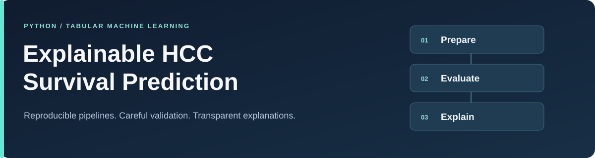

# Explainable HCC Survival Prediction

A Python machine-learning project exploring one-year survival prediction with tabular
clinical data. It brings together reusable preprocessing, model comparison, careful
validation, and a local Streamlit demonstration.

[Getting started](#getting-started) · [Workflow](#workflow) ·
[Documentation](docs/README.md) · [Contributing](CONTRIBUTING.md)

> **For education and research only.** This prototype is not clinically validated or
> deployment ready. Do not use it for diagnosis, patient prognosis communication,
> treatment selection, triage, resource allocation, or any other medical decision.

## What the project includes

| Component | Implemented capabilities |
| --- | --- |
| Data handling | Explicit UCI retrieval, a checked-in 49-feature schema, target validation, and missing-value handling |
| Preprocessing | Numerical, categorical, and ordinal transformations fitted inside training folds |
| Model comparison | A dummy baseline, two logistic-regression benchmarks, a constrained random forest, and optional CPU XGBoost |
| Evaluation | Repeated nested stratified cross-validation, training-only calibration and threshold selection, and patient-level uncertainty summaries |
| Explainability | Held-out permutation importance, variability across folds, and local explanatory plots |
| Interface | A command-line workflow and a local Streamlit demo with validated single-record and batch inputs |
| Engineering | Synthetic tests, lint and formatting checks, package-content checks, and recorded local run metadata |

The emphasis is on making the modeling decisions inspectable: how missing values are
handled, how models are compared, and how probabilities are evaluated. The current
explanation workflow uses permutation importance; it does not generate SHAP explanations.

## Getting started

Use **Python 3.11 or 3.12**. Run the commands from the repository root.

### 1. Clone and create an environment

~~~console
git clone https://github.com/hamzaelmassaoudy/explainable-hcc-survival-prediction.git
cd explainable-hcc-survival-prediction
python -m venv .venv
~~~

Activate the environment using the command for your shell:

| Shell | Command |
| --- | --- |
| PowerShell | `.\.venv\Scripts\Activate.ps1` |
| Bash / Zsh | `source .venv/bin/activate` |

### 2. Install and check the package

~~~console
python -m pip install --upgrade pip
python -m pip install -e ".[dev,app,boosting]"
python -m hcc_survival --help
python -m pytest -m "not integration"
~~~

The `app` extra installs Streamlit; `boosting` installs XGBoost for the supplied
configurations. Installation and ordinary tests do not retrieve the dataset.

### 3. Run a local example

~~~console
python -m hcc_survival download
python -m hcc_survival validate-data
python -m hcc_survival train --config configs/fast.yaml --fit-final
streamlit run app/streamlit_app.py
~~~

Dataset retrieval requires internet access. Training creates an ignored local run directory
and, with `--fit-final`, a local model for the app. If that model is absent, the app displays
the recovery command. The fast configuration is for development; it is not the full
internal-validation analysis.

## Workflow

~~~mermaid
flowchart LR
    A[Retrieve and validate data] --> B[Fit preprocessing in training folds]
    B --> C[Tune and calibrate models]
    C --> D[Evaluate held-out probabilities]
    D --> E[Summarize and explain locally]
~~~

The outcome is **one-year survival**, with `1 = survived at one year` and
`0 = died within one year`. Every prediction uses that direction. This is a fixed-horizon
binary prediction task; the project studies predictive associations, not causal effects.

| Configuration | Outer folds | Repetitions | Inner folds | Bootstrap resamples | Purpose |
| --- | ---: | ---: | ---: | ---: | --- |
| [fast.yaml](configs/fast.yaml) | 3 | 1 | 2 | 200 | Development and smoke runs |
| [full.yaml](configs/full.yaml) | 5 | 5 | 3 | 2,000 | Full internal-validation analysis |

In the full design, each patient receives five held-out probabilities. These are averaged
at patient level before aggregate metrics and bootstrap intervals are calculated.
Preprocessing, tuning, calibration, threshold selection, and data-derived feature choices
remain within training partitions. An optional final fit uses all available data and has
no independent performance estimate. See the [methods](docs/METHODS.md) for details.

<strong>Run the full workflow and inspect local outputs</strong>

~~~console
python -m hcc_survival train --config configs/full.yaml --fit-final
python -m hcc_survival sensitivity --config configs/full.yaml
~~~

Training prints the newly created directory under `artifacts/runs/`. Use that directory
with the `--run-dir` option of the `report` and `explain` commands. Each command also
provides its own help:

~~~console
python -m hcc_survival report --help
python -m hcc_survival explain --help
python -m hcc_survival sensitivity --help
~~~

Run configurations and package versions are recorded locally. Detailed instructions and
determinism limits are in the [reproducibility guide](docs/REPRODUCIBILITY.md).

## Dataset and interpretation

The project uses the [UCI HCC Survival dataset](https://archive.ics.uci.edu/dataset/423/hcc+survival):
**165 records and 49 predictors**, UCI ID 423,
[DOI 10.24432/C5TS4S](https://doi.org/10.24432/C5TS4S), licensed under CC BY 4.0.
The loader checks the schema, target coding, and record count before writing a local cache.

The small single-source cohort, substantial missingness, model-selection optimism, and
lack of external validation limit the conclusions that can be drawn. Bootstrap intervals
describe conditional internal-validation uncertainty. See the [data card](docs/DATA_CARD.md),
[model card](docs/MODEL_CARD.md), and [limitations](docs/LIMITATIONS.md).

**The public repository contains source, configurations, tests, and documentation.**
Patient-level data, fitted models, predictions, run artifacts, generated reports, plots,
tables, and logs remain local and ignored. No benchmark result or clinical-performance
claim is published here. See the [data policy](docs/PRIVACY.md). The app is a local
demonstration and must not receive identifiable health information.

## Repository map

~~~text
src/hcc_survival/   Package: data, preprocessing, models, evaluation, and prediction
app/               Local Streamlit demonstration
configs/           Fast and full experiment settings
tests/             Synthetic unit and workflow tests
docs/              Guides, methods, data and model cards, and project policies
data/              Dataset instructions and ignored local cache directories
scripts/           Local verification and distribution-content checks
.github/           Continuous integration and contribution templates
~~~

## Documentation

| Start here | Read next |
| --- | --- |
| [Documentation index](docs/README.md) | All guides organized by purpose |
| [Learning guide](docs/LEARNING_GUIDE.md) | Modeling concepts and metric interpretation |
| [Methods](docs/METHODS.md) | Validation, calibration, thresholds, and uncertainty |
| [Reproducibility](docs/REPRODUCIBILITY.md) | Environment, commands, and local run outputs |
| [Development](docs/DEVELOPMENT.md) | Package structure and quality checks |
| [Test evidence](docs/TEST_EVIDENCE.md) | The behaviors covered by synthetic tests |

## Contributing

Focused improvements to documentation, tests, and existing workflows are welcome.
Read the [contribution guide](CONTRIBUTING.md) before opening an issue or pull request.
Report vulnerabilities using the [security policy](SECURITY.md), and follow the
[code of conduct](CODE_OF_CONDUCT.md).

## Author, citation, and license

Maintained by [Hamza El Massaoudy](https://github.com/hamzaelmassaoudy).
Original repository code is available under the [MIT License](LICENSE).
Software citation metadata is provided in [CITATION.cff](CITATION.cff).

Dataset attribution: Santos, M., Abreu, P., Garcia-Laencina, P., Simao, A., and Carvalho, A.
(2015). *HCC Survival*. UCI Machine Learning Repository. DOI 10.24432/C5TS4S.
The dataset is separately licensed under CC BY 4.0; dependencies retain their own licenses.
